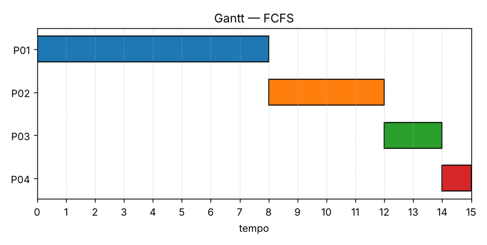
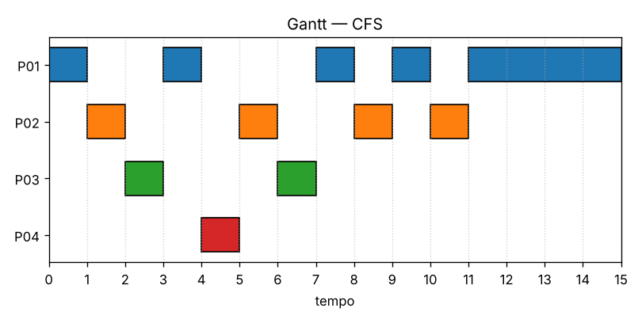
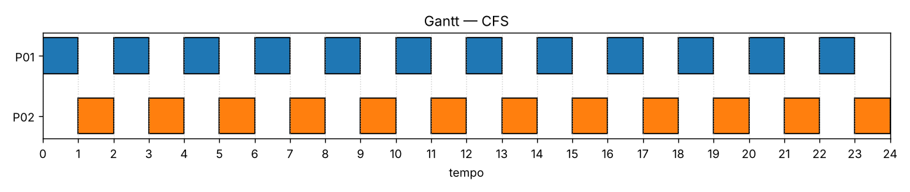
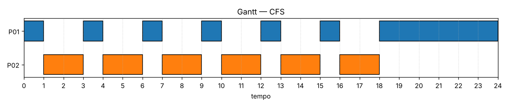

# Relatório — Simulação de escalonamento: FCFS × CFS

Dupla 1: Lucas Mello e Rafael Santos.

## Experimento 1: conjunto comum

Processos: P01 (chegada 0, CPU 8), P02 (1, 4), P03 (2, 2), P04 (4, 1).

### FCFS

| Processo | 1ª exec. | Conclusão | Turnaround | Espera | Resposta |
|---|---|---|---|---|---|
| P01 | 0 | 8 | 8 | 0 | 0 |
| P02 | 8 | 12 | 11 | 7 | 7 |
| P03 | 12 | 14 | 12 | 10 | 10 |
| P04 | 14 | 15 | 11 | 10 | 10 |
| **Média** | | | **10,5** | **6,75** | **6,75** |

P01 é o único pronto em t=0 e executa até o fim. Os demais chegam durante a execução de P01, entram no fim da fila e executam na ordem de chegada. Não há preempção.

### CFS

| Processo | 1ª exec. | Conclusão | Turnaround | Espera | Resposta |
|---|---|---|---|---|---|
| P01 | 0 | 15 | 15 | 7 | 0 |
| P02 | 1 | 11 | 10 | 6 | 0 |
| P03 | 2 | 7 | 5 | 3 | 0 |
| P04 | 4 | 5 | 1 | 0 | 0 |
| **Média** | | | **7,75** | **4,0** | **0,0** |

A cada unidade, executa o processo de menor `vruntime`. Com peso 1024, cada unidade executada soma 1. Decisões principais:
- **t=1:** P02 chega com o menor `vruntime` presente (1), empatando com P01. Como P02 nunca executou, ele ganha o desempate e **interrompe P01**.
- **t=2 e t=4:** o mesmo acontece com P03 e P04. Quem chega herda o menor `vruntime` e ganha o empate por nunca ter executado.
- **t=5:** P01, P02 e P03 empatam em 2. Vence P02, que está sem executar desde t=2, há mais tempo que os outros.
- **t=11:** só resta P01, que executa até 15.

Houve preempções em t = 1, 2, 4, 5, 8 e 10.

### Comparação

| Média | FCFS | CFS |
|---|---|---|
| Turnaround | 10,5 | **7,75** |
| Espera | 6,75 | **4,0** |
| Resposta | 6,75 | **0,0** |

Nesse conjunto, o CFS melhorou as três médias. No FCFS, o processo longo P01 chegou primeiro e fez os curtos esperarem (efeito comboio). Em troca, o turnaround de P01 piorou de 8 para 15, e o CFS fez 12 trechos de execução contra 4 do FCFS. As trocas de contexto não pesam no modelo, mas teriam custo real.

## Experimento 2: casos elaborados pela dupla

| Caso | Objetivo | Processos (chegada, CPU) |
|---|---|---|
| 2a | CPU ociosa no início e entre chegadas | P01 (1,2), P02 (6,3), P03 (7,1) |
| 2b | Durações diferentes e chegadas durante uma execução | P01 (0,7), P02 (2,3), P03 (3,1), P04 (5,4) |
| 2c | Empates: chegadas simultâneas e CPUs iguais, com o arquivo fora de ordem | P01 (0,3), P02 (0,3), P03 (2,2), P04 (2,2) |

| Caso | Algoritmo | Linha do tempo | Turnaround | Espera | Resposta |
|---|---|---|---|---|---|
| 2a | FCFS | OCIOSO[0,1) P01[1,3) OCIOSO[3,6) P02[6,9) P03[9,10) | 2,667 | 0,667 | 0,667 |
| 2a | CFS | OCIOSO[0,1) P01[1,3) OCIOSO[3,6) P02[6,7) P03[7,8) P02[8,10) | 2,333 | 0,333 | 0 |
| 2b | FCFS | P01[0,7) P02[7,10) P03[10,11) P04[11,15) | 8,25 | 4,5 | 4,5 |
| 2b | CFS | alterna P01, P02, P03 e P04 até 15 (ver Gantt) | 8,25 | 4,5 | 0 |
| 2c | FCFS | P01[0,3) P02[3,6) P03[6,8) P04[8,10) | **5,75** | **3,25** | 3,25 |
| 2c | CFS | P01 P02 P03 P04 P01 P02 P03 P04 P01 P02 (1 unidade cada) | 7,5 | 5,0 | **0,5** |

Os diagramas de Gantt de cada caso estão em `experimentos/gantt/exp2*.png`.

- **2b:** as médias de turnaround e espera ficaram iguais. O CFS fez P03 terminar bem antes, mas atrasou P01, e um efeito compensou o outro.
- **2c:** com processos de tamanhos parecidos, o **FCFS foi melhor** em turnaround e espera, porque a alternância do CFS faz todos terminarem perto do fim. Os desempates seguiram o ID nas chegadas simultâneas e, no CFS, a ordem "nunca executou" → "mais tempo sem executar".

### Conferência manual (caso 2a)

**FCFS:** CPU ociosa em [0,1). P01 executa em [1,3). Ociosa em [3,6), porque P02 só chega em 6. P02 executa em [6,9). P03 chega em 7 e espera até 9, executando em [9,10).
- P01: turnaround 3−1 = 2, espera 2−2 = 0, resposta 0
- P02: turnaround 9−6 = 3, espera 0, resposta 0
- P03: turnaround 10−7 = 3, espera 3−1 = 2, resposta 9−7 = 2
- Médias: 8/3 = 2,667; 2/3 = 0,667; 2/3 = 0,667 ✔

**CFS:** P01 chega em 1 com `vruntime` 0 e executa até 3, terminando com `vruntime` 2. Como ninguém mais está presente, a referência fica em 2. P02 chega em 6 com 2 e executa uma unidade (vai para 3). P03 chega em 7 com o menor presente (3), empata com P02 e vence por nunca ter executado. Ele termina em 8, e P02 executa em [8,10).
- P01: 2 / 0 / 0
- P02: turnaround 10−6 = 4, espera 4−3 = 1, resposta 0
- P03: turnaround 8−7 = 1, espera 0, resposta 0
- Médias: 7/3 = 2,333; 1/3 = 0,333; 0 ✔

## Experimento 3: CFS com pesos iguais × diferentes

Dois processos longos, P01 e P02, com CPU 12, chegam em t=0 e disputam a CPU. A comparação é feita no intervalo [0, 18), em que os dois estão prontos nos dois cenários. O tempo total de CPU não serve para comparar, porque ele é fixado pela entrada.

| Pesos (P01 / P02) | CPU de P01 em [0,18) | CPU de P02 em [0,18) |
|---|---|---|
| 1024 / 1024 | 9 | 9 |
| 1024 / 2048 | 6 | 12 |

Com pesos iguais, os `vruntime` sobem no mesmo ritmo e os processos alternam a cada unidade, dividindo a CPU meio a meio. Com peso 2048, cada unidade de P02 soma só 0,5 ao seu `vruntime`, então ele executa duas unidades para cada uma de P01: a divisão segue a proporção dos pesos (2:1). Como resultado, P02 conclui em 18 em vez de 24.

## Conclusão

O FCFS é simples e se saiu bem com processos de tamanho parecido (2c), mas sofre com o efeito comboio (1 e 2b). O CFS responde imediatamente a quem chega e divide a CPU conforme os pesos, mas troca de processo muito mais vezes. Nenhum desses resultados prova que um algoritmo seja superior em qualquer situação.
